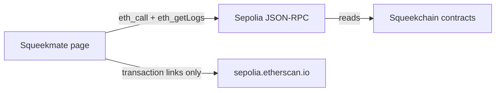

<p align="center">
  <a href="https://squeekmate.xyz">
    
  </a>
</p>

<p align="center">
  <a href="https://squeekmate.xyz">
  </a>
</p>

<p align="center">
  <a href="https://squeekmate.xyz"><b>Live app</b></a>
  · Sepolia testnet · 100% on-chain · full signing + Claim SQK · no build step
</p>

Squeekmate is a small handheld console in the browser. Connect a wallet, watch an address, or visit a token id, and one Squeek sits on the LCD. Levels, merge state, claimable SQK, wheel state, and the activity feed are read directly from the Squeekchain contracts on Sepolia — there is no off-chain API. Care buttons, the nap timer, and Spin Dash stay on this page.

The app sends exactly one transaction type: **Claim SQK**, through the connected wallet's signer (Reown AppKit + ethers). Everything else is a read. Connecting a wallet asks that wallet for permission to share an account and to sign the claim when you confirm it.

squeekchain-project: 25bd4d64-4072-4e65-933f-e6de29f5954d

**Live app:** [https://squeekmate.xyz](https://squeekmate.xyz)

## Contents

- [The console](#the-console)
- [Feature matrix](#feature-matrix)
- [How data moves](#how-data-moves)
- [Run it locally](#run-it-locally)
- [Repository layout](#repository-layout)
- [On-chain data layer](#on-chain-data-layer)
- [Polling, retries, and failure](#polling-retries-and-failure)
- [The wheel](#the-wheel)
- [Wallet, Sepolia, and Etherscan](#wallet-sepolia-and-etherscan)
- [Care, themes, and sound](#care-themes-and-sound)
- [Honest limitations](#honest-limitations)

## The console

Four tabs. The deployed file on `main` is one self-contained document: [`index.html`](index.html) (all CSS and JS inlined, no build step). The repo also retains `styles.css`, `app.js`, `docs/`, and `assets/` from the earlier multi-file layout.

| Tab | What it holds |
| --- | --- |
| **Pet** | LCD, care row (Feed, Play, Nap, Pet), Spin Dash, vitals, and the on-chain card |
| **Pack** | Squeeks returned for the connected or watched address, plus Visit Any Squeek |
| **World** | Wheel, core counters, SQK economy chart, and Chain Activity |
| **Wallet** | Connection, balances, claimable SQK, power, stake, and the last earnings window |

Visit Any Squeek accepts a token id from **1 through 9999**. Random draws **1 through 8017** (`1 + Math.floor(8017 * Math.random())`).

Spin Dash runs for 15 seconds. Its tap target is `max(20, round(0.9 × RPM))` when RPM is above zero, and **45** when it is not. RPM reads **0** in the on-chain build (there is no on-chain source for live device telemetry), so the tap target is 45 unless a measurement arrives from elsewhere.

## Feature matrix

| Surface | What you see | Source (all on-chain, Sepolia) |
| --- | --- | --- |
| Pet artwork and level | Name, level, merge state, traits, base power, next merge block | SqueekNFT `ownerOf` / `level` / `nextMergeHeight` / `tokenURI` (metadata decoded locally from the on-chain tokenURI: SVG data-URI image + traits) |
| LCD background removal | Character drawn over the theme when the SVG can be cleaned | `cleanSqueekSvg` / `squeekArtUri` in the page. The original data URI is kept when cleaning does not apply |
| Energy | Bar plus an RPM sentence | SqueekCore settled-round state; RPM is 0 (no on-chain device telemetry), then session care nudges |
| Fullness | Bar | `blockProgress` from SqueekCore `state()`, then session feeds |
| Mood | Bar | Squeek level, merge state, and claimable SQK, then session care |
| Bond | Bar | Session care counts only. Nothing writes bond back on-chain |
| Nap | 45-second local timer and a sleep pose on the pet | `S.napUntil`. There is no on-chain sleep field |
| Wheel picture | Inline SVG rotor `#wvRotor` | [`index.html`](index.html) and `updateWheelViz` in the page |
| Core counters | Block, work, work per 1,000 blocks, settled round, progress | SqueekCore `state()` via `eth_call`, live on every refresh. No hardcoded snapshot |
| SQK economy | Supply, mined, burned, staked, NFT live/issued, merges open, bar / graphic / pie | SqueekToken + SqueekMining + SqueekStaking via `eth_call` |
| Chain Activity | All, Protocol, Players, My activity | Raw contract event logs via `eth_getLogs` (BatchSettled, Checkpointed, Staked, RewardClaimed, and others) with block timestamps |
| Transaction chip | Text link “Etherscan” when the hash matches `0x` plus 64 hex digits | `https://sepolia.etherscan.io/tx/…` |
| SQK and Squeek counts | Wallet SQK, Squeek NFT balance, Sepolia ETH | Sepolia `eth_call` `balanceOf` and `eth_getBalance` |
| Claimable SQK, power, stake, pack, earnings | Account panel and pack grid | SqueekStaking (`claimable`, `claimRecipient`, stake) + SqueekNFT `ownerOf` + Transfer / staking deposit / withdraw / merge logs |
| Your Earnings | Bar, graphic, and pie for up to the last 7 / 14 / 30 days | `RewardClaimed` / `ClaimedAndStaked` logs, selectable view (Bar / Graphic / Pie) and range (7 / 14 / 30 days) |
| Shell badge and claim row image | Squeekchain mark | Inlined as a data URI in [`index.html`](index.html). The repo file [`assets/squeekchain-mark.jpg`](assets/squeekchain-mark.jpg) is base64 text, not a binary JPEG — the deployed page does not depend on it |
| Claim SQK | Button in the On-Chain card; confirmation with amount, recipient, contract, account, network, and gas estimate; sends `SqueekStaking.claim(account)` | Connected wallet signer via Reown AppKit + ethers. Claim selector `0x1e83409a` |

## How data moves



There is no off-chain API and no WebSocket and no server in this repository. **Zero requests go to `api.squeekchain.com` or any other off-chain API.** Every data read is a JSON-RPC POST to a Sepolia endpoint (primary `ethereum-sepolia-rpc.publicnode.com`, fallbacks `sepolia.drpc.org` and `ethereum-sepolia.blockpi.network/v1/rpc/public`). Pet images and traits are decoded locally from the on-chain `tokenURI`. Chain Activity copy in the page says the list is live from the chain and refreshes every 5 seconds. That sentence describes the poll, not a stream.

The 15-second world refresh also calls the current feed category, including while the tab is hidden. The dedicated 5-second timer runs only when `document.hidden` is false, and once more when the tab becomes visible again.

## Run it locally

Any static file server is enough. From this directory:

```bash
python3 -m http.server 8000
```

Open `http://127.0.0.1:8000`. The public site is [https://squeekmate.xyz](https://squeekmate.xyz).

A wallet that holds a Squeek is optional: Watch any address, or visit a token id, still loads public on-chain data.

Fonts (Quicksand, Barlow Condensed, IBM Plex Mono) are requested from Google Fonts. Reown AppKit is loaded from esm.sh. The WalletConnect mark on the button is loaded from `cdn.simpleicons.org`, and several extension logos are remote images. Those are runtime requests, not a compile step.

## Repository layout

```text
index.html                 deployed single-file app (all CSS/JS inlined, BUILD v30)
styles.css                 earlier multi-file layout (retained, not used by the deployed file)
app.js                     earlier multi-file layout (retained, not used by the deployed file)
docs/readme-header.png     wordmark used at the top of this README
assets/squeekchain-mark.jpg
assets/wallets/logo-0.svg
```

`main` does not contain `wheel.js` or a separate wheel image set. The rotor is the `#wvRotor` group in [`index.html`](index.html).

## On-chain data layer

The data layer is in the single [`index.html`](index.html) on `main`. All reads are direct `eth_call` / `eth_getLogs` against the official Squeekchain contracts on Sepolia (release `core-sepolia-20261103`, deploy block `12057556`). All 25 function selectors and 12 event topics were verified against the official ABI files with ethers — zero mismatches.

| Contract | Address (Sepolia 11155111) |
| --- | --- |
| SqueekCore | `0xFD6C166D4B8E2962E65746a13e5a0797CD4dE0c4` |
| SqueekNFT | `0xC4C7982657f00509548F3a3a41db7FA439a6856B` |
| SqueekToken ($SQK) | `0xd78a3956cF63164d1Fa1C622ad3c66623162Fa1e` |
| SqueekMining | `0x2dCcB11fcC2dEfdd188555e45aCb52231e82e218` |
| SqueekStaking | `0x50fd1780526C3186A0c037c7622203bC4fb611ca` |

| Read | Used for |
| --- | --- |
| SqueekCore `state()` | Wheel / core: block height, block progress, cumulative work, work per thousand blocks, settled round, difficulty |
| SqueekToken + SqueekMining + SqueekStaking | SQK economy: total supply, mined, burned, premint, cap, staking totals, reward stream, issuance schedule, NFT live / issued, merges open |
| SqueekNFT `ownerOf` / `level` / `nextMergeHeight` / `tokenURI` | The pet: owner, level, merge state, next merge block, base power, artwork + traits (decoded from the on-chain tokenURI) |
| Transfer + staking deposit / withdraw / merge logs (verified against `ownerOf`) | Pack: Squeeks held for the connected or watched address, including staking custody |
| SqueekStaking `claimable` / `claimRecipient` | Claimable SQK, power, stake |
| `RewardClaimed` / `ClaimedAndStaked` logs | Your Earnings |
| Raw contract event logs (`eth_getLogs`, per-contract topic filters, 6,000-block feed window) | Chain Activity (All / Protocol / Players) and My Activity, with block numbers and timestamps |

The layer retries across the fallback RPC endpoints when a public endpoint returns an error (including the transient `pruned history unavailable` on log scans). Log queries use per-contract topic filters and a 6,000-block feed window.

## Polling, retries, and failure

| Timer | What it requests | When it stops |
| --- | --- | --- |
| 15 seconds | Core state, economy state, then the current feed category | It keeps firing, including in a hidden tab |
| 5 seconds | Current feed category only | Skipped while `document.hidden` is true |
| Immediate | Same feed request | When the tab becomes visible |

RPC reads retry across the fallback endpoints:

- A failed endpoint is retried on the next endpoint in the list (primary, then drpc, then blockpi).
- A repeated log scan that hits `pruned history unavailable` is retried the same way; the identical call succeeds on other runs.
- After the last fallback fails the error is thrown. Callers decide what stays on screen.

What stays on screen:

| Failure | What the page does |
| --- | --- |
| Core read fails | Previous core numbers stay. If none have arrived, the counters stay empty (no hardcoded snapshot) |
| Economy read fails | Previous economy text and chart stay. Before the first success, the chart is empty |
| Events fail | The list is replaced with an error sentence |
| Squeek load fails | Up to 3 extra tries, 3.5 seconds apart, then the LCD empty state and Try again |

There is no hardcoded snapshot and no seeded chart in the on-chain build. A pulsing live dot means the latest core read succeeded. It does not mean every other figure was refreshed in that same moment.

## The wheel

On `main`, the World wheel is the inline SVG in [`index.html`](index.html). `updateWheelViz` only changes that drawing:

| Condition in the page | What the SVG does |
| --- | --- |
| The local nap timer is still running | Class `wheelviz state-sleep`. This follows the Nap button on the pet, not an on-chain field |
| SqueekCore settled rounds are advancing | Class `state-run`. The wheel state (settled work, difficulty, block progress) is exact on-chain data |
| No fresh core read | Class `state-idle` |

There is no separate hamster sprite and no `wheel.js` on `main`. Live RPM, speed, and distance read **0** in the on-chain build: instantaneous device telemetry exists only in the off-chain device service and has no on-chain source. The Wheel derives its state from SqueekCore's settled rounds instead. The sleep class is the local 45-second nap.

## Wallet, Sepolia, and Etherscan

| Item | Value in code |
| --- | --- |
| Chain | Sepolia, id `11155111`, hex `0xaa36a7` |
| Primary RPC | `https://ethereum-sepolia-rpc.publicnode.com` |
| RPC fallbacks | `https://sepolia.drpc.org`, then `https://ethereum-sepolia.blockpi.network/v1/rpc/public` |
| ETH balance | `eth_getBalance` on the primary RPC only |
| SQK token | `0xd78a3956cf63164d1fa1c622ad3c66623162fa1e`, `balanceOf` (`0x70a08231`) |
| Squeek NFT | `0xc4c7982657f00509548f3a3a41db7fa439a6856b`, `balanceOf` |
| Staking | `0x50fd1780526c3186a0c037c7622203bc4fb611ca`, `claimable` (`0x402914f5`), `claimRecipient` (`0x9e8a8a64`), `claim` (`0x1e83409a`) |
| Explorer | `https://sepolia.etherscan.io`, including `/tx/{hash}` |
| Add-chain payload | Native currency “Sepolia ETH”, the primary RPC, and that explorer |

Wallet connection is Reown AppKit 1.8.24 + Ethers adapter (from esm.sh), Sepolia only. The project id is the app owner's own Reown project id, and `squeekmate.xyz` must be allowlisted on [dashboard.reown.com](https://dashboard.reown.com) for production. Network switching uses AppKit's own `modal.switchNetwork(Sepolia)` for WalletConnect (raw `wallet_switchEthereumChain` is kept for injected wallets). Chain state comes from AppKit (`subscribeNetwork` / `getChainId`).

Claim SQK is the app's only transaction. It reads claimable SQK and the claim recipient fresh, simulates via `staticCall` + `estimateGas`, shows a confirmation dialog (amount, recipient, contract, account, network, 0 ETH value, gas estimate), sends `SqueekStaking.claim(account)` through the connected wallet's signer, links the Etherscan transaction, waits for the receipt, then refreshes claimable SQK and the SQK balance. It needs Sepolia ETH for gas.

Watch any address sets no provider and assumes Sepolia. It can still load the public on-chain account, pack, and activity data.

A session is stored in `localStorage` under `squeekmate-session-v1` with build tag `2026-11-09-v30`. Disconnect removes it. A different build tag removes it on the next load, so a redeploy that changes the tag asks you to connect again. The tag match is a reload check, not a signature.

## Care, themes, and sound

Feed, Play, Nap, and Pet change session counters and the speech bubble. Nap lasts 45 seconds and adds energy only inside `computeVitals`. Leaving nap for another care action clears the timer. Pet copy states that the on-chain level stays until a real merge. Merge instructions point at the wallet on Squeekchain; this page does not send the merge.

LCD themes are `home`, `beach`, `forest`, `snow`, `desert`, and `city`, remembered as `squeekmate-lcd-theme`. Appearance is `auto`, `light`, or `dark` (`squeekmate-lcd-mode`). Auto is light from 06:00 through 17:59 local time and dark otherwise, rechecked every 30 seconds.

Button sounds start on (`S.sound` is true). The chiptune loop starts off.

## Honest limitations

- The live app link is [https://squeekmate.xyz](https://squeekmate.xyz).
- The app is 100% on-chain for data: zero requests to `api.squeekchain.com` or any other off-chain API. All reads are direct Sepolia `eth_call` / `eth_getLogs` against the official contracts above.
- Chain Activity is polled. The visible-tab interval is 5 seconds. Core and economy are polled every 15 seconds. Nothing here subscribes to a stream.
- The first paint of the core counters and the economy chart is empty until the first successful on-chain read. A failed later poll keeps the last successful numbers. Not every figure is a live reading on every visit.
- Live RPM, speed, and distance read 0: the hamster wheel's instantaneous device telemetry has no on-chain source. The Wheel derives its state from SqueekCore's settled rounds. Local nap adds the class `state-sleep` for 45 seconds. That class is not an on-chain sleep state.
- The Squeekchain mark is inlined as a data URI in the deployed page. The repo file [`assets/squeekchain-mark.jpg`](assets/squeekchain-mark.jpg) is base64 text, not a binary JPEG; the deployed page does not depend on it. This repository does not establish the mark as the official SQK token logo.
- Care, bond, nap, and Spin Dash are local. They do not post anywhere on-chain.
- Balances and logs come from public Sepolia RPC endpoints. If those endpoints fail, the affected cells become an em dash or an error sentence. A log scan can transiently hit `pruned history unavailable`; the layer retries across the fallback endpoints.
- The app is a Sepolia testnet interface. It does not claim mainnet balances. It sends exactly one transaction type (Claim SQK); it does not submit merges or transfers.
- Connected-wallet states (pack with a real Squeek, the claim button) need a real wallet on a phone to verify visually.
