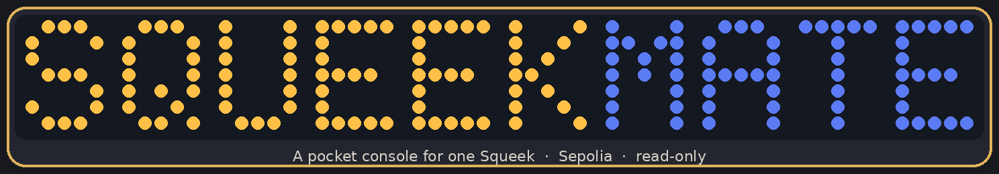
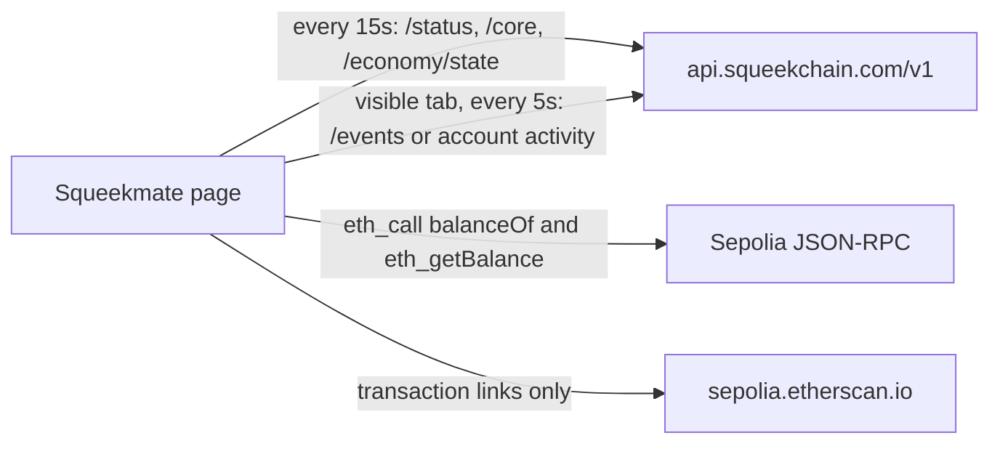

<p align="center">
  
</p>

<p align="center">
  
</p>

<p align="center">
  <b>Intended public site</b> · <a href="https://squeekmate.xyz">squeekmate.xyz</a><br>
  <b>Hosted fallback</b> · <a href="https://squeekmate.vercel.app">squeekmate.vercel.app</a><br>
  Sepolia testnet · static files · no build step
</p>

Squeekmate is a small handheld console in the browser. Connect a wallet, watch an address, or visit a token id, and one Squeek sits on the LCD. Levels, merge state, claimable SQK, wheel speed, and the activity feed are read from Squeekchain. Care buttons, the nap timer, and Spin Dash stay on this page.

The app never sends a transaction and never calls a signing method. Connecting an extension still asks that wallet for permission to share an account.

## Contents

- [The console](#the-console)
- [Feature matrix](#feature-matrix)
- [How data moves](#how-data-moves)
- [Run it locally](#run-it-locally)
- [Repository layout](#repository-layout)
- [Squeekchain API](#squeekchain-api)
- [Polling, retries, and failure](#polling-retries-and-failure)
- [The wheel](#the-wheel)
- [Wallet, Sepolia, and Etherscan](#wallet-sepolia-and-etherscan)
- [Care, themes, and sound](#care-themes-and-sound)
- [Domains](#domains)
- [Honest limitations](#honest-limitations)

## The console

Four tabs. The page is one static document: [`index.html`](index.html), [`styles.css`](styles.css), [`app.js`](app.js), and [`wheel.js`](wheel.js).

| Tab | What it holds |
| --- | --- |
| **Pet** | LCD, care row (Feed, Play, Nap, Pet), Spin Dash, vitals, and the on-chain card |
| **Pack** | Squeeks returned for the connected or watched address, plus Visit Any Squeek |
| **World** | Wheel, core counters, SQK economy chart, and Chain Activity |
| **Wallet** | Connection, balances, claimable SQK, power, stake, and the last earnings window |

Visit Any Squeek accepts a token id from **1 through 9999**. Random draws **1 through 8017** (`1 + Math.floor(8017 * Math.random())`).

Spin Dash runs for 15 seconds. Its tap target is `max(20, round(0.9 × RPM))` when the latest status measurement has RPM above zero, and **45** when it does not.

## Feature matrix

| Surface | What you see | Source in this repo |
| --- | --- | --- |
| Pet artwork and level | Name, level, merge state, traits, base power, next merge block | `GET /v1/squeeks/{id}` |
| LCD background removal | Character drawn over the theme when the SVG can be cleaned | `cleanSqueekSvg` / `squeekArtUri` in [`app.js`](app.js). The original data URI is kept when cleaning does not apply |
| Energy | Bar plus an RPM sentence | Latest `measurement` on `GET /v1/status`, then session care nudges |
| Fullness | Bar | `core.blockProgress` from `GET /v1/core` when that body is `available`, then session feeds |
| Mood | Bar | Squeek level, merge state, and claimable SQK, then session care |
| Bond | Bar | Session care counts only. Nothing writes bond back to the API |
| Nap | 45-second local timer and a sleep pose on the pet | `S.napUntil`. The status API has no sleep field |
| Wheel picture | Wooden rotor turns. Stand and hamster stay put | [`wheel.js`](wheel.js) plus [`assets/wheel/`](assets/wheel/) |
| Core counters | Block, work, work per 1,000 blocks, settled round, progress | `GET /v1/core` after it arrives. Until then, the hardcoded `SNAPSHOT` |
| SQK economy | Supply, mined, burned, staked, NFT live/issued, merges open, bar / dots / pie | `GET /v1/economy/state`. The chart is seeded first from constants in [`app.js`](app.js) |
| Chain Activity | All, Protocol, Players, My activity | `GET /v1/events` or `GET /v1/accounts/{address}/activity` |
| Transaction chip | Etherscan link when the hash matches `0x` plus 64 hex digits | `https://sepolia.etherscan.io/tx/…` and [`assets/etherscan.png`](assets/etherscan.png) |
| SQK and Squeek counts | Wallet SQK, Squeek NFT balance, Sepolia ETH | Sepolia `eth_call` `balanceOf` and `eth_getBalance` |
| Claimable SQK, power, stake, pack, earnings | Account panel and pack grid | `GET /v1/accounts/{address}` |
| Your Earnings | Bar and pie for up to the last 7 `earnings` rows | Same account payload. The dots view is not in the page; a stored `dots` choice is shown as bars |
| Shell badge and claim row image | Squeekchain mark | [`assets/squeekchain-mark.jpg`](assets/squeekchain-mark.jpg). This repo does not identify that file as an SQK token logo |

## How data moves



There is no WebSocket and no server in this repository. `apiGet` uses `fetch` with `cache: "no-store"`. Chain Activity copy in the page says the list is live from the Squeekchain API and refreshes every 5 seconds. That sentence describes the poll, not a stream.

The 15-second world refresh also calls the current feed category, including while the tab is hidden. The dedicated 5-second timer runs only when `document.hidden` is false, and once more when the tab becomes visible again.

## Run it locally

Any static file server is enough. From this directory:

```bash
python3 -m http.server 8000
```

Open `http://127.0.0.1:8000`. A wallet that holds a Squeek is optional: Watch any address, or visit a token id, still loads public API data.

Fonts (Quicksand, Barlow Condensed, IBM Plex Mono) are requested from Google Fonts. WalletConnect’s library is loaded from jsDelivr when a visitor clicks WalletConnect. Several extension logos are remote images. Those are runtime requests, not a compile step.

## Repository layout

```text
index.html          page, tabs, and the wordmark
styles.css          gadget, LCD themes, charts
app.js              API client, wallet, vitals, feed, economy
wheel.js            canvas wheel driven by /v1/status
docs/readme-header.png
assets/squeekchain-mark.jpg
assets/etherscan.png
assets/wallets/     WalletConnect mark and generic wallet placeholder
assets/wheel/       background, rotor, stand, hamster, source artwork
```

## Squeekchain API

The data client is already in the app. This README records it.

| Piece | Where |
| --- | --- |
| Base URL `https://api.squeekchain.com/v1` | [`app.js`](app.js) line 1, constant `API` |
| `apiGet`, `refreshWorld`, `loadFeed`, `loadSqueek`, `loadAccount` | same file, the first script block |
| 15-second world timer | [`app.js`](app.js) line 18, `setInterval(refreshWorld, 15e3)` |
| 5-second event timer | [`app.js`](app.js) lines 35–38 |
| Wheel rules for that status body | [`wheel.js`](wheel.js) |
| WalletConnect session metadata | [`app.js`](app.js): `metadata.url` is `https://squeekmate.xyz` and the icon is `https://squeekmate.xyz/assets/squeekchain-mark.jpg`. This is not a `/v1` data call |

`apiGet(path)` requests `API + path`, sends `accept: application/json`, and aborts after 12 seconds.

| Call | Used for |
| --- | --- |
| `GET /status` | `measurement` (core status, `rpmMilli`, speed, distance), `oracle.state`, `settlementQueue.state` |
| `GET /core` | Painted only when `status` is `"available"` and `core` is present: block height, block progress, cumulative work, work per thousand blocks, settled round |
| `GET /economy/state` | Painted only when `status` is `"available"`: supply, staking total, NFT live/issued, merges open, chain safe block, lifecycle stage and round, schedule |
| `GET /events?category={all\|protocol\|players}&limit=40` | Chain Activity for those three chips |
| `GET /accounts/{address}/activity?limit=40` | My activity. Requires a connected or watched address |
| `GET /accounts/{address}?limit=100` | Pack, rewards, power, stake, earnings. Further pages use `cursor` |
| `GET /squeeks/{id}` | The pet. A body whose `status` is not `"available"` is treated as a failed load |

Fields the wheel reads from `measurement`: `coreStatus`, `rpmMilli`, `freshness`, `receivedAt`, `observedAt`, `staleAfterSeconds`. `IDLE` with `rpmMilli` above zero is still a running rotor. Zero milli-RPM is stopped. The client does not invent a sleep value.

Account and event bodies that are not `"available"` surface `reason` when the API sends one. The feed then says the indexer may be catching up. A thrown `fetch` says the feed, the account, or the Squeek could not be reached.

## Polling, retries, and failure

| Timer | What it requests | When it stops |
| --- | --- | --- |
| 15 seconds | `/status`, `/core`, `/economy/state`, then the current feed category | It keeps firing, including in a hidden tab |
| 5 seconds | Current feed category only | Skipped while `document.hidden` is true |
| Immediate | Same feed request | When the tab becomes visible |

`apiGet` retries twice more (three tries total):

- HTTP 429 or any status of 500 and above waits for `Retry-After`, clamped between 1 and 5 seconds. A missing header waits 2 seconds.
- Any other failure waits `1200 × attempt` milliseconds. A failed `/status` marks the live dot off before that wait.
- After the last failure the error is thrown. Callers decide what stays on screen.

What stays on screen:

| Failure | What the page does |
| --- | --- |
| `/status` fails | Live dot turns off and the wheel runs `hold()` (“Update failed”). The last RPM, speed, distance, and core label are left as they were |
| `/core` fails, or `status` is not `"available"` | Previous core numbers stay. If none have arrived, the startup snapshot stays |
| `/economy/state` fails, or `status` is not `"available"` | Previous economy text and chart stay. Before the first success, the chart is the hardcoded seed |
| Events fail | The list is replaced with an error sentence |
| Squeek load fails | Up to 3 extra tries, 3.5 seconds apart, then the LCD empty state and Try again |

Startup snapshot, written before the first successful `/core`:

| Field | Hardcoded value |
| --- | --- |
| `blockHeight` | 1999, labeled “(snapshot)” until `/core` replaces it |
| `cumulativeWork` | 18553 |
| `workPerThousandBlocks` | 8238 |
| `settledThroughRound` | 533 |
| `blockProgress` | 322478319, stored on `SNAPSHOT` and not copied into the progress bar at startup |

SQK chart seed, used until `supply.capBaseUnits` arrives: premint `210000000` SQK, launch bonus `105000000` SQK, cap `2100000000` SQK, each with 18 decimal base units in the source. Mined starts at zero. A successful economy response replaces premint, mined, burned, staked, and the bonus amount from `schedule.launchBonusBaseUnits`.

Those seeds and the snapshot are why a number on screen can be a placeholder or a previous response. A green live dot means the latest `/status` payload had a measurement whose `coreStatus` is `ACTIVE`. It does not mean every other figure was refreshed in that same moment.

## The wheel

[`wheel.js`](wheel.js) draws four local images: background, rotor, stand, hamster. Only the rotor rotates, around the hub. Angular speed while running is `RPM × 6` degrees per second. A two-pixel bob on the hamster is part of that running drawing. It is not an API pose.

| Measurement | Rotor |
| --- | --- |
| No measurement | Stopped. Label “Unavailable” |
| `freshness` is `"stale"`, or the sample is older than `staleAfterSeconds` (default 120) when freshness is neither `"online"` nor `"stale"` | Stopped. Label “Stale” and the last RPM |
| `coreStatus` is `COUNTER_FAULT` | Stopped. Label “COUNTER_FAULT” |
| Fresh, not a fault, RPM above zero | Spins at that RPM. `IDLE` is allowed |
| Fresh, not a fault, RPM is zero | Stopped. Label includes “stopped”. It is not called asleep |
| `hold()` after a status request fails | Stopped. Label “Update failed” |

Motion also pauses for `prefers-reduced-motion: reduce`, a hidden document, or a canvas that is not on screen. The angle resets to zero when the mode is not `"run"`.

## Wallet, Sepolia, and Etherscan

| Item | Value in code |
| --- | --- |
| Chain | Sepolia, id `11155111`, hex `0xaa36a7` |
| Primary RPC | `https://ethereum-sepolia-rpc.publicnode.com` |
| `eth_call` fallbacks | `https://sepolia.drpc.org`, then `https://ethereum-sepolia.blockpi.network/v1/rpc/public` |
| ETH balance | `eth_getBalance` on the primary RPC only |
| SQK token | `0xd78a3956cf63164d1fa1c622ad3c66623162fa1e`, `balanceOf` (`0x70a08231`) |
| Squeek NFT | `0xc4c7982657f00509548f3a3a41db7fa439a6856b`, `balanceOf` |
| Staking constant | `0x50fd1780526c3186a0c037c7622203bc4fb611ca` is declared and not passed to `eth_call` |
| Explorer | `https://sepolia.etherscan.io`, including `/tx/{hash}` |
| Add-chain payload | Native currency “Sepolia ETH”, the primary RPC, and that explorer |

Extension wallets are discovered with EIP-6963 and `window.ethereum`. The connect call is `eth_requestAccounts`. If the chain is not Sepolia, the page calls `wallet_switchEthereumChain`, and on code `4902` or `-32603` it calls `wallet_addEthereumChain`. Names and icons prefer the EIP-6963 record. Logo URLs are matched when the name contains metamask, rabby, coinbase, brave, trust, okx, or phantom.

WalletConnect uses the public project id `75702030b4763bda309d919e1a76233b` already in [`app.js`](app.js). The button opens the QR modal on Sepolia (`11155111`). The session methods are `eth_chainId`, `eth_accounts`, `wallet_switchEthereumChain`, and `wallet_addEthereumChain`. The page does not request a signature or a transaction. There is no project-id field for visitors. The button mark is [`assets/wallets/walletconnect.svg`](assets/wallets/walletconnect.svg). Extension connect and Watch any address stay as they are. A QR session is not a connected wallet until a wallet approves it.

Watch any address sets no provider and assumes Sepolia. It can still load the public account, pack, and activity routes.

A session is stored in `localStorage` under `squeekmate-session-v1` with build tag `2026-11-08-v17`. Disconnect removes it. A different build tag removes it on the next load, so a redeploy that changes the tag asks you to connect again. The tag match is a reload check, not a signature.

## Care, themes, and sound

Feed, Play, Nap, and Pet change session counters and the speech bubble. Nap lasts 45 seconds and adds energy only inside `computeVitals`. Leaving nap for another care action clears the timer. Pet copy states that the on-chain level stays until a real merge. Merge instructions point at the wallet on Squeekchain; this page does not send the merge.

LCD themes are `home`, `beach`, `forest`, `snow`, `desert`, and `city`, remembered as `squeekmate-lcd-theme`. Appearance is `auto`, `light`, or `dark` (`squeekmate-lcd-mode`). Auto is light from 06:00 through 17:59 local time and dark otherwise, rechecked every 30 seconds.

Button sounds start on (`S.sound` is true). The chiptune loop starts off.

## Domains

| URL | Role | Check on 8 Nov 2026 |
| --- | --- | --- |
| [https://squeekmate.xyz](https://squeekmate.xyz) | Intended primary public address | The name did not resolve from the environment used to write this file (`Name or service not known`). HTTPS on that name was not verified |
| [https://squeekmate.vercel.app](https://squeekmate.vercel.app) | Secondary host for the static app | HTTP 200. That response is the last production deploy of the app, not a deploy of later documentation commits |

This repository does not change DNS. Updating this README does not publish the site and does not attach a Vercel alias.

## Honest limitations

- Chain Activity is polled. The visible-tab interval is 5 seconds. Status, core, and economy are polled every 15 seconds. Nothing here subscribes to a stream.
- The first paint of the core counters is the hardcoded snapshot above. Economy slices start from the hardcoded cap, premint, and launch bonus. A failed later poll keeps the last successful numbers. Not every figure is a live reading on every visit.
- The wheel rotates from `measurement.rpmMilli` under the freshness and fault rules above. The API sample used by the client has no hamster running state and no sleep state. A still wheel is stopped, stale, faulted, or unavailable.
- [`assets/squeekchain-mark.jpg`](assets/squeekchain-mark.jpg) is the Squeekchain mark on the shell and on the claimable-SQK row. This repository does not establish it as the official SQK token logo.
- [squeekmate.xyz](https://squeekmate.xyz) is the chosen public name. The DNS check recorded above did not show it serving the app. Use [squeekmate.vercel.app](https://squeekmate.vercel.app) when you need the host that answered.
- Care, bond, nap, and Spin Dash are local. They do not post to `/v1`.
- Balances come from public Sepolia RPC endpoints. If those endpoints fail, the balance cells become an em dash. Account data can still load from the API, and the other way around.
- The app is a read-only Sepolia interface. It does not claim mainnet balances, and it does not submit merges, claims, or transfers.
